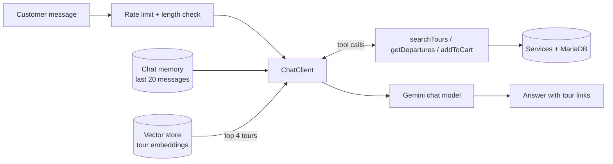

# TourBooking

A bilingual (Vietnamese / English) tour booking website built with Spring Boot, Thymeleaf and MariaDB. Customers search for tours, pick a departure, check out, pay and review; admins manage tours, departures, orders, refunds, promotions and see revenue and behaviour statistics. An optional AI layer (Spring AI + Google Gemini) adds semantic tour search, similar-tour recommendations and a RAG chatbot that can call tools. If no API key is configured, the AI layer switches itself off and the rest of the app works unchanged.

## Features

**Customers**
- Browse and filter tours by category, destination, price and sort order; keyword search or natural-language search (see AI features).
- Tour detail pages with itinerary, images, departures with seats left, and approved reviews.
- Session-based cart, checkout with a passenger list, promotion codes, and payment records.
- Account area: order history and detail, self-service cancellation with a refund policy, profile and password change, reviews for completed tours.
- Registration (welcome email), login, VI/EN language switch.

**Admins**
- Dashboard with revenue statistics and an analytics page built from tracked user events.
- CRUD for tours (image upload), categories, departures, promotions (with usage history) and users.
- Order management: confirm, complete, cancel (with automatic refund of paid amounts), read-only order detail with passenger lists.
- Review moderation and contact-message inbox.
- AI admin page: index status and a "re-index" button for the tour vector index.

## AI features

All AI features are optional and degrade gracefully: if the API key is missing, the provider fails or nothing is found, the app falls back to plain keyword search / same-category recommendations.

| Feature | How it works |
|---|---|
| Semantic search | Each active tour is turned into a text document (name, category, destination, duration, transport, description) and embedded with `gemini-embedding-001`. A query is embedded, matched against the vector store (top-k 30, similarity threshold 0.5) with metadata filters for price and category, and a small parser extracts price hints from the sentence. Falls back to keyword (`LIKE`) search. |
| Similar tours / "You may like" | Nearest neighbours in the same vector index, re-ranked with a popularity weight (0.7 similarity + 0.3 popularity) using the user's recent tracked events. Falls back to same category, then to popular tours. |
| RAG chatbot | Spring AI `ChatClient` with a system prompt, a 20-message sliding conversation memory per session, a `QuestionAnswerAdvisor` that retrieves the top 4 matching tours from the vector store, and tool calling. Rate limited per session, message length capped at 500 characters. |

Chatbot tools (`ai/TourTools.java`):
- `searchTours(query, maxPriceVnd)` - semantic search, up to 5 tours.
- `getDepartures(tourId)` - bookable departures with seats left and prices.
- `addToCart(departureId, adults, children)` - adds to the visitor's session cart. There is deliberately no payment or order tool; the customer completes checkout themselves.

If the provider rejects a tool-calling round with a 4xx error (e.g. a missing `thought_signature` on Gemini 3 models), the service retries once with a RAG-only client without tools.



Models and defaults (all overridable by environment variables): chat `gemini-2.5-flash` (`AI_CHAT_MODEL`), embeddings `gemini-embedding-001` (`AI_EMBEDDING_MODEL`). The vector store is Spring AI's `SimpleVectorStore` (in memory, persisted to `data/vector-store.json`); the 20 seeded tours are indexed at startup and a tour is re-indexed whenever an admin changes it.

## Tech stack

| Area | Technology |
|---|---|
| Language / runtime | Java 21 |
| Framework | Spring Boot 3.5.16 (Web MVC, Data JPA, Security, Validation, Mail) |
| AI | Spring AI 1.1.8 (Google GenAI starter for chat, OpenAI-compatible starter for embeddings, `SimpleVectorStore`, `QuestionAnswerAdvisor`) |
| View | Thymeleaf with Spring Security extras, Bootstrap 5.3.3, jQuery 3.7.1, Bootstrap Icons 1.11.3 (WebJars) |
| Database | MariaDB (developed against 12.2) via the MariaDB JDBC driver; Hibernate with `ddl-auto=validate` |
| Build | Maven (wrapper included), Lombok |
| Tests | JUnit 5, Spring Boot Test, Spring Security Test, H2 in MariaDB mode |

## Architecture

```
HTTP -> Controller (web / admin / api) -> Service -> Repository (Spring Data JPA) -> MariaDB
                                           |-> ai/ (embedding, vector store, chat, tools)
                                           |-> events: email after commit, vector re-index on tour change
```

- Controllers handle HTML (Thymeleaf), form posts (always redirect-after-post) and a REST layer under `/api` for AJAX. Business rules live in the service layer, in Java; the database only enforces keys.
- Role-based access with Spring Security (`USER`, `ADMIN`); `/admin/**` and `/api/admin/**` require `ADMIN`, checkout and account pages require login.
- **Order state machine** (`entity/BookingStatus.java`): `PENDING -> CONFIRMED | CANCELLED`, `CONFIRMED -> COMPLETED | CANCELLED`; `COMPLETED` and `CANCELLED` are final. Every change is recorded in `booking_status_history`.
- **Pessimistic locking**: departures (`TourDepartureRepository.findByIdForUpdate`), orders (`BookingRepository.findByCodeForUpdate`) and promotions (`PromotionRepository.findByIdForUpdate`) are loaded with `PESSIMISTIC_WRITE` (`SELECT ... FOR UPDATE`) while seats are reserved, statuses change or coupons are consumed, so concurrent requests cannot overbook a departure or double-spend a coupon.
- **Refunds and cancellation**: customers can cancel themselves only far enough ahead of departure; refund percentage is 100% beyond the full-refund window, otherwise a configured partial percentage (`app.booking.*` in `application.properties`).
- **Auto-cancellation**: a scheduled job runs every 15 minutes and cancels `PENDING` orders older than 24 hours that have no paid payment.
- Departures stop being bookable a configurable number of days before departure (`app.booking.cutoff-days`).
- Enums are stored through dedicated `AttributeConverter`s (no `CHECK` constraints); emails are sent after commit through an `EmailService` with a console implementation (default) and an SMTP implementation.

## Run locally

Prerequisites: JDK 21+, MariaDB 11.x or newer, and (optionally) a free Gemini API key from Google AI Studio.

1. **Create the database.** Run the scripts in `database/` in order. `01_create_database.sql` must be run by a MariaDB admin user (it creates the `TourBookingDB` schema and the `tourapp` user); `02_schema.sql` creates the 17 tables. `03_seed_data.sql` is optional: with the default `dev` profile the app seeds demo users, 6 categories, 20 tours with departures and sample orders on its first start if the database is empty.
2. **Set the database password.** The `tourapp` user and its password are defined in `database/01_create_database.sql` and read in `src/main/resources/application.properties`. Choose your own password in both places, or override it at run time without editing files:
   ```bash
   export DB_URL="jdbc:mariadb://localhost:3306/TourBookingDB"      # default
   export SPRING_DATASOURCE_USERNAME="tourapp"
   export SPRING_DATASOURCE_PASSWORD="<your-database-password>"
   ```
3. **(Optional) enable AI.**
   ```bash
   export GEMINI_API_KEY="<your-gemini-api-key>"   # empty or missing = AI disabled
   export AI_CHAT_MODEL="gemini-2.5-flash"         # optional override
   ```
   Other optional variables: `AI_ENABLED`, `AI_EMBEDDING_MODEL`, `AI_VECTOR_STORE_PATH`, `AI_SIMILARITY_THRESHOLD`, and `AI_CHAT_PROVIDER=openai` with `AI_BASE_URL`, `AI_CHAT_PATH`, `AI_EMBEDDINGS_PATH` to use an OpenAI-compatible server instead.
4. **(Optional) real emails.** The default `app.mail.mode=console` only logs emails. For SMTP set `app.mail.mode=smtp` plus `MAIL_HOST`, `MAIL_PORT`, `MAIL_USERNAME`, `MAIL_PASSWORD`, `MAIL_FROM`.
5. **Start the app.**
   ```bash
   ./mvnw spring-boot:run
   ```
   Open http://localhost:8081 (change with `PORT`). The demo admin account is `admin@tourbooking.vn`; demo passwords are defined in `config/DataSeeder.java` and are for local use only.

If the database already exists from an earlier version, run `database/05_user_events.sql` (idempotent) to add the behaviour-tracking table.

## Tests

```bash
./mvnw test
```

The 86 automated tests need no MariaDB and no API key: they run on in-memory H2 in MariaDB mode, and the AI tests use a fake Gemini server that also enforces the `thought_signature` rule. They cover the price-hint parser, embedding throttling, vector indexing and search, chat service and tool loop, recommendations, behaviour tracking and statistics, the rate limiter, and full-application smoke tests with AI enabled and disabled.

## Project structure

```
database/                 MariaDB scripts: create DB, schema (17 tables), seed data, sample queries, drop
src/main/java/vn/edu/iuh/fit/tourbooking/
  ai/                     Embeddings, vector store, semantic search, chat service, chatbot tools
  config/                 Security, i18n, AI wiring, properties, demo data seeder
  controller/             web/ (customers), admin/ (back office), api/ (REST + AJAX)
  dto/                    Forms and view DTOs
  entity/                 JPA entities, enums, attribute converters
  exception/              Business-rule and API/global exception handling
  mapper/                 Entity -> DTO mapping
  repository/             Spring Data repositories and specifications
  security/               UserDetails, login handler, API error handlers
  service/                Business logic (bookings, payments, promotions, stats, tracking, email)
  session/                Session-scoped cart
  util/ validation/       Helpers, rate limiter, custom validators
src/main/resources/       application.properties, i18n bundles (vi/en), Thymeleaf templates, static assets
src/test/                 JUnit tests, fake Gemini server, H2 test profile
```
